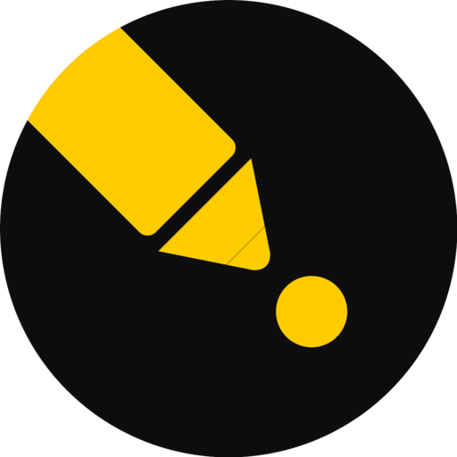
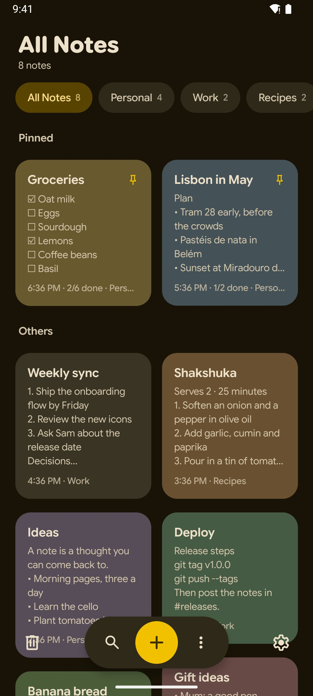
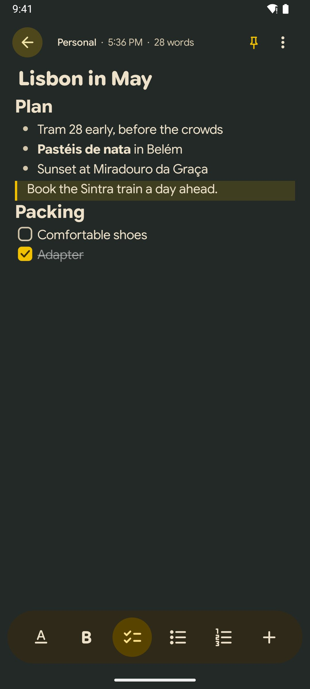
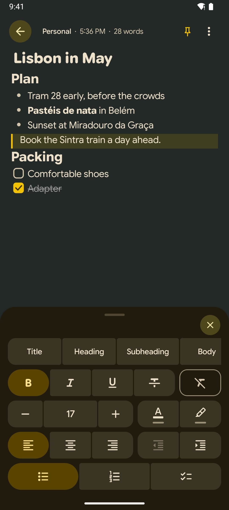

<p align="center"></p>

<h1 align="center">mi. Notes</h1>

<p align="center">
  <strong>A simple, private Android notes app built around a single control: the Pill.</strong>
</p>

<p align="center">
  <a href="https://github.com/mi-app-hub/mi-notes/releases/latest"></a>
  
  
  
  <a href="LICENSE"></a>
</p>

<p align="center">
  <a href="https://rookieenough.github.io/Orion-Data/redirect.html?id=mi-notes"></a>
</p>

<p align="center">
  
  
  
</p>

**mi. Notes** is a notes app that stays out of your way. Your notes sit in folders on one calm page, with a Pill at the bottom to search them, start a new one, and swipe to Settings or Recently Deleted. Write with real formatting and lists that behave, pin what matters, and hold a note to drag it where you want it. Everything stays on your phone, in a plain format you can back up, export as Markdown, and take anywhere.

**[Website](https://mi-app-hub.github.io/mi-notes)** · **[User Guide](https://mi-app-hub.github.io/mi-notes/user)** · **[Download](https://github.com/mi-app-hub/mi-notes/releases/latest)**

## Highlights
- **One Pill for everything**: tap + for a new note, hold to search, swipe for Settings or Recently Deleted. In a note it becomes your toolbar: swipe right to undo, left to redo, up to go back.
- **One note, one text**: the title is simply the first line, so you can select across it, and a note with a blank first line has no title.
- **Rich text**: Title, Heading and Subheading styles; bold, italic, underline, strikethrough; any text size you type; text colours and highlights; alignment. All on one small panel where the keyboard was.
- **Lists that behave**: bullets, numbers and checklists carry on with Enter and end with Enter twice, six levels deep. Ticked items can move to the bottom.
- **Dividers, quotes, code blocks and callouts** from the toolbar's +. They export to Markdown as `---`, `> `, fenced code and GitHub's `> [!NOTE]`, and come back the same way.
- **Scan text** from a photo or a picture, read on your phone, lists and all: boxes become a checklist (ticked ones ticked), dots and dashes bullets, numbers a numbered list, read from the marks on the page. Into the note you're writing from the toolbar's +, or a new note from the ⋮ menu.
- **Folders, pins and colours**: pick a folder from its chip, hold a note to rearrange it, give notes a colour.
- **Nothing is lost**: Undo after every delete, undo and redo while writing, and Recently Deleted (30 days by default).
- **Your data, your files**: one-file backups (`.minotesdata`), Markdown export of every note, and Markdown or text import. Share a note as text or as a Markdown file, or send text from any app into a new note.
- **Shortcuts and automation**: New Note on the app icon, and `minotes://new` and `minotes://append` links for apps like Tasker (they only ever add text).
- **Material 3 Expressive**: colours from your wallpaper, pure black dark mode, staggered, grid or list layouts, haptics and smooth motion.
- **No accounts, no tracking.** The only connection is a check with GitHub for a newer version.

See everything mi. Notes does in the **[User Guide](https://mi-app-hub.github.io/mi-notes/user)**.

## Install
Download the APK from the **[latest release](https://github.com/mi-app-hub/mi-notes/releases/latest)** and open it on your phone (Android 8.0 or newer, 64-bit: any phone from the last several years). mi. Notes checks for updates itself and shows what's new after each one.

## Build from source
Requires Android Studio, or JDK 21 with the Android SDK (compileSdk 37).

```bash
git clone https://github.com/mi-app-hub/mi-notes.git
cd mi-notes
./gradlew installDebug         # build and install on a connected device
./gradlew testDebugUnitTest    # run the unit tests
```

How the code is organized is in the **[Developer Guide](https://mi-app-hub.github.io/mi-notes/developer)** and [CLAUDE.md](CLAUDE.md). The website lives in [`docs/`](docs) (Next.js); its colours are generated from the app's default accent by `docs/scripts/theme.mjs`.

## More mi. Apps
- [mi. Browser](https://github.com/mi-app-hub/mi-browser): a simple, private browser built around one Pill.
- [mi. Budget](https://github.com/mi-app-hub/mi-budget): your purchases, budgets and subscriptions, private on your phone.

## License
[MIT](LICENSE). The bundled font (Google Sans Flex, SIL Open Font License), icons (Material Symbols, Apache 2.0) and text recognition (Google ML Kit, ML Kit Terms of Service) keep their own licenses. mi. Notes collects no personal data: see the [Privacy Policy](https://mi-app-hub.github.io/mi-notes/privacy).
