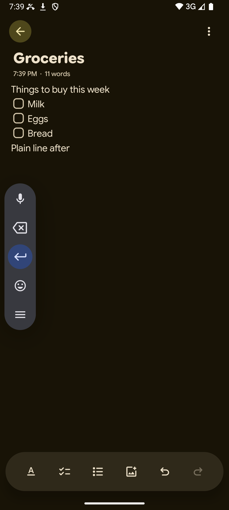
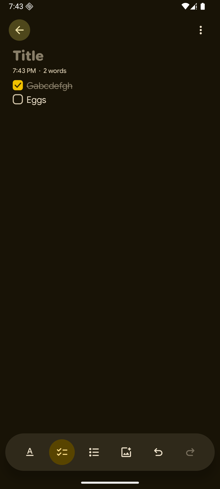
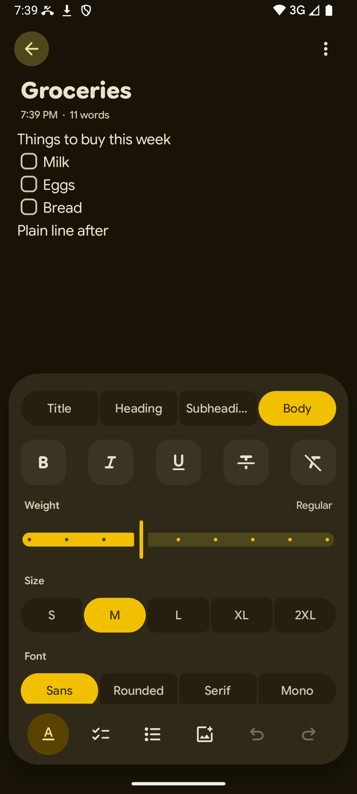

<p align="center"></p>

<h1 align="center">mi. Notes</h1>

<p align="center"><b>A simple, private notes app built around one Pill: write, format and find your notes with a swipe.</b></p>

<p align="center">
  
  
  
  
  
</p>

<p align="center">
  
  
  
</p>

mi. Notes is a notes app that stays out of your way. Your notes sit in folders on one calm page, with a Pill at the
bottom to search them and start a new one. Write with real formatting (sizes, weights, colours, highlights, fonts,
lists and checklists), pin what matters, and hold a note to drag it where you want it. Everything stays on your phone,
in a plain format you can back up, export as Markdown, and take anywhere.

## Highlights

- **Rich text:** Title, Heading and Subheading styles; bold, italic, underline, strikethrough; any weight from Thin to
  Black; five sizes; Sans, Rounded, Serif and Mono; text colours and highlights; alignment.
- **Lists that behave:** bullets, numbers and checklists that carry on with Enter, end on an empty line, and indent
  six levels deep. Ticked items can move to the bottom.
- **Pictures** in any note.
- **Folders, pins and colours:** swipe the Pill between folders, hold a note to rearrange it, give notes and folders a
  colour.
- **Nothing is lost:** Undo after every delete, undo and redo while writing, and Recently Deleted for 30 days.
- **Your data, your files:** one-file backups (`.minotes`), Markdown export of every note, and Markdown or text import.
  Share a note as text or as a Markdown file, or send text from any app into a new note.
- **Private:** no accounts, no tracking, and no internet permission at all.

## Install

Download the latest APK from [Releases](https://github.com/jleesCY/mi-notes/releases) and open it on your phone.

## Build from source

```sh
git clone https://github.com/jleesCY/mi-notes.git
cd mi-notes
./gradlew :app:assembleDebug        # app/build/outputs/apk/debug/
./gradlew :app:testDebugUnitTest    # unit tests
```

Requires the Android SDK (compileSdk 37) and JDK 21.

## License

MIT. Bundled assets keep their own licences: Google Sans Flex (SIL Open Font License) and Material Symbols
(Apache 2.0).
